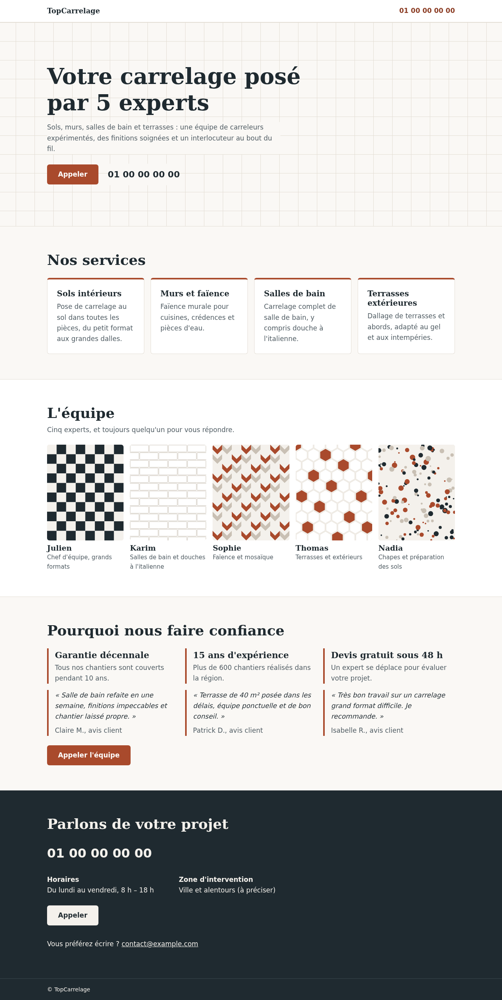

# TopCarrelage

[](https://github.com/saumon/carrelage/actions/workflows/quality.yml)
[](https://github.com/saumon/carrelage/commits/dev)
[](lighthouserc.json)
[](https://validator.w3.org/nu/)
[](https://validator.w3.org/nu/)
[](.github/workflows/quality.yml)

Landing page de **TopCarrelage**, une équipe de 5 experts en pose de carrelage. Une seule page statique, responsive, pensée pour un objectif : que le visiteur **appelle**.



> [!WARNING]
> Une partie du contenu est **provisoire**, y compris des **preuves de confiance et avis clients fictifs**. Ils doivent être remplacés par du contenu réel avant toute mise en ligne. Voir [Contenu provisoire](#contenu-provisoire).

## Fonctionnalités

- **Appel en un geste** : numéro en lien `tel:` dès le premier écran, bouton d'appel fixe sur mobile, bloc de contact en fin de page.
- **Sections** : services, équipe des 5 experts, preuves de confiance, contact (horaires, zone d'intervention).
- **Responsive** de 320 px au grand écran, conçu d'abord pour le mobile.
- **Rapide et autonome** : HTML et CSS uniquement, aucun JavaScript, aucun service tiers, moins de 15 Ko transférés.
- **Accessible** : hiérarchie de titres, contrastes suffisants, cibles tactiles d'au moins 44 px, page déclarée en français.

## Démarrage rapide

Aucune installation ni étape de build. Avec Python 3 :

```sh
python3 -m http.server 8000
```

Puis ouvrir <http://localhost:8000>. Ouvrir directement `index.html` dans un navigateur fonctionne aussi.

## Structure du projet

```text
.
├── index.html               # la page
├── style.css                # styles ; charte provisoire dans les variables CSS de :root
├── images/                  # illustrations des 5 experts (SVG provisoires)
├── docs/apercu.png          # capture utilisée dans ce README
├── lighthouserc.json        # configuration et seuils Lighthouse CI
├── .github/workflows/
│   └── quality.yml          # CI : validation et audit Lighthouse
└── openspec/
    ├── specs/               # spécifications du comportement de la page
    └── changes/             # changements en cours et archivés
```

## Contrôles qualité

Chaque push, sur toutes les branches, et chaque pull request déclenchent le workflow [`Qualité`](.github/workflows/quality.yml), avec deux jobs :

| Job | Vérifie | Échoue si |
|---|---|---|
| Validation HTML, CSS et SVG | `index.html`, `style.css` et `images/*.svg` avec le [validateur Nu du W3C](https://validator.github.io/validator/) ; absence de `<script>` | une erreur de validation est trouvée, ou la page contient du JavaScript |
| Audit Lighthouse | la page en mode mobile, médiane de 3 exécutions | performance < 90, ou accessibilité, bonnes pratiques ou SEO < 95 |

Le rapport Lighthouse complet, en HTML et JSON, est téléchargeable dans l'artefact `rapport-lighthouse` de chaque exécution.

Les badges statiques ci-dessus (Lighthouse, HTML, CSS, JavaScript) décrivent ce que ces contrôles imposent. Si vous modifiez les seuils de `lighthouserc.json`, mettez aussi à jour le badge Lighthouse.

### Lancer les contrôles en local

Ces commandes demandent Node.js. La validation demande aussi Java, et Lighthouse un Chrome ou Chromium installé.

```sh
# Validation HTML, CSS et SVG
npx -p vnu-jar@26.10.12 vnu --also-check-css --also-check-svg index.html style.css images/*.svg

# Absence de JavaScript (aucune sortie attendue)
grep -niE '<script' index.html

# Audit Lighthouse avec les seuils de la CI (rapports dans .lighthouseci/)
npx @lhci/cli@0.15.1 autorun
```

Sans Java, le validateur existe aussi en binaire autonome (`vnu.linux.zip`, `vnu.osx.zip`, `vnu.windows.zip`) sur la [page des versions](https://github.com/validator/validator/releases). Si Chrome n'est pas trouvé automatiquement, indiquez son chemin dans la variable `CHROME_PATH`.

### Régénérer l'aperçu

Après un changement visuel, recapturer la page sur desktop, en ajustant la hauteur à celle de la page :

```sh
google-chrome --headless=new --hide-scrollbars --window-size=1280,2548 \
  --screenshot=docs/apercu.png "file://$PWD/index.html"
```

## Contenu provisoire

Tout élément encore provisoire porte l'attribut `data-placeholder`. Pour les lister :

```sh
grep -n data-placeholder index.html
```

Sont concernés :
- le numéro de téléphone, l'email, les horaires et la zone d'intervention ;
- les textes de présentation et des services ;
- les prénoms et spécialités des experts, ainsi que les illustrations qui remplacent leurs portraits ;
- **les preuves de confiance et les avis clients, qui sont fictifs**.

La spécification [`trust-signals`](openspec/specs/trust-signals/spec.md) interdit de publier des preuves fictives. Les remplacer par des preuves réelles, ou les supprimer, est un préalable à la mise en ligne.

## Workflow de développement

Le projet suit [OpenSpec](https://github.com/Fission-AI/OpenSpec) : le comportement attendu de la page est décrit dans [`openspec/specs/`](openspec/specs/), et chaque évolution passe par un changement qui propose, spécifie, conçoit puis implémente.

| Spécification | Couvre |
|---|---|
| [`call-to-action`](openspec/specs/call-to-action/spec.md) | lien `tel:`, bouton d'appel fixe, bloc de contact, absence de formulaire |
| [`services-presentation`](openspec/specs/services-presentation/spec.md) | liste des services, place prévue pour une future galerie |
| [`team-presentation`](openspec/specs/team-presentation/spec.md) | présentation des 5 experts |
| [`trust-signals`](openspec/specs/trust-signals/spec.md) | preuves de confiance factuelles |
| [`responsive-layout`](openspec/specs/responsive-layout/spec.md) | adaptation aux écrans, accessibilité, autonomie |

Avec Claude Code, les commandes `/opsx:explore`, `/opsx:propose`, `/opsx:apply` et `/opsx:archive` couvrent ce cycle.

## Déploiement

Pas encore défini. Le site étant entièrement statique, tout hébergement de fichiers convient (GitHub Pages, Netlify, Cloudflare Pages…). Il suffit de publier `index.html`, `style.css` et `images/`.

## Droits

© TopCarrelage. Tous droits réservés. Ce dépôt est public mais n'est pas distribué sous licence open source : le code, les textes, le nom et les visuels ne peuvent pas être réutilisés sans autorisation.
